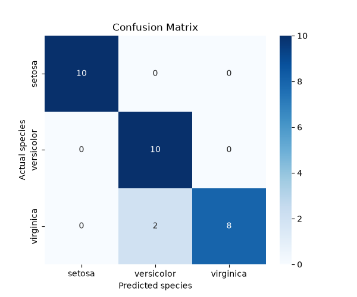
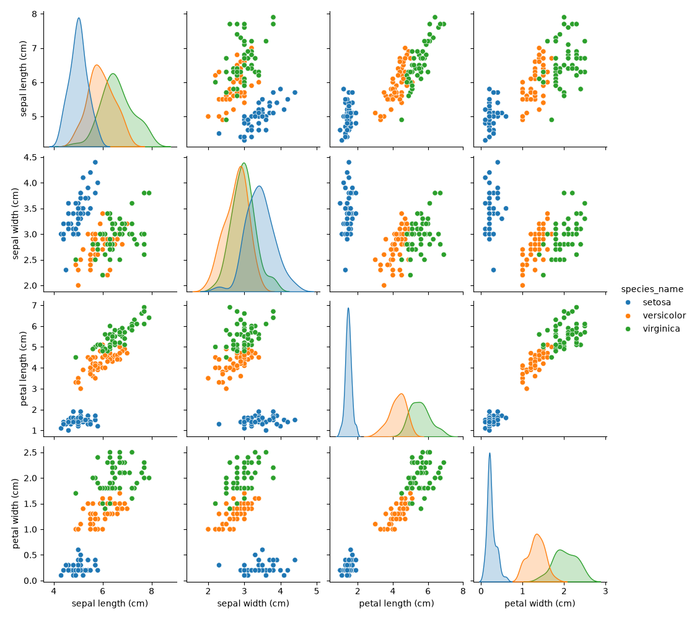
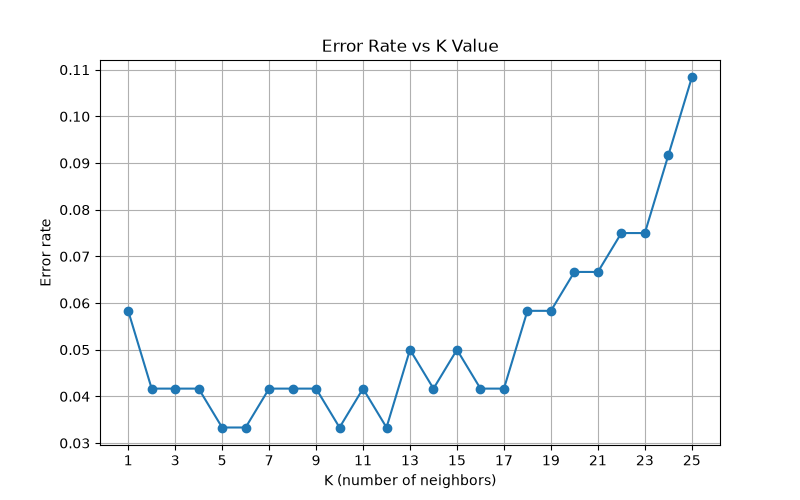
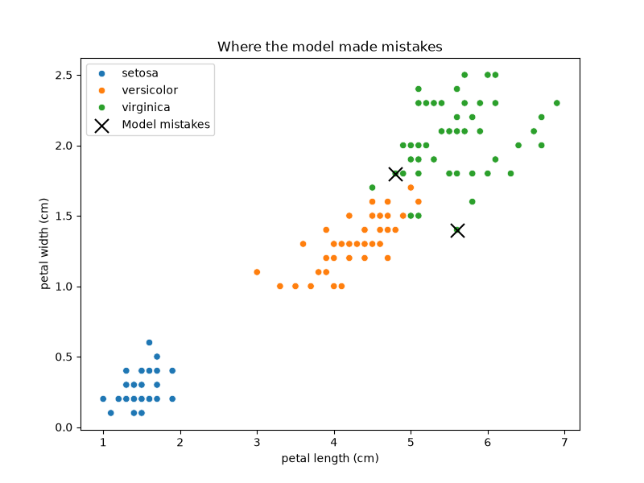
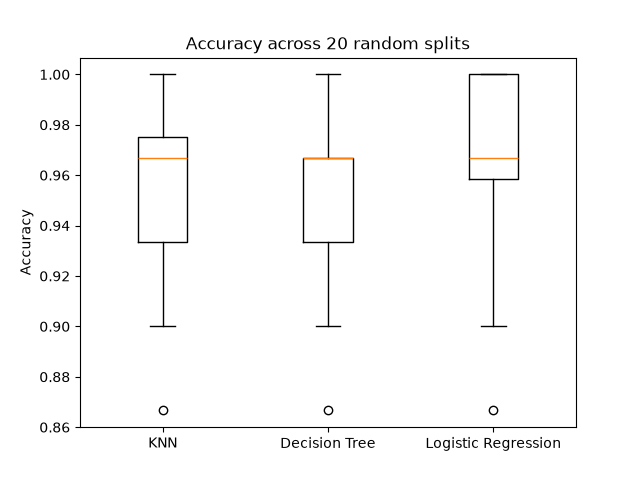
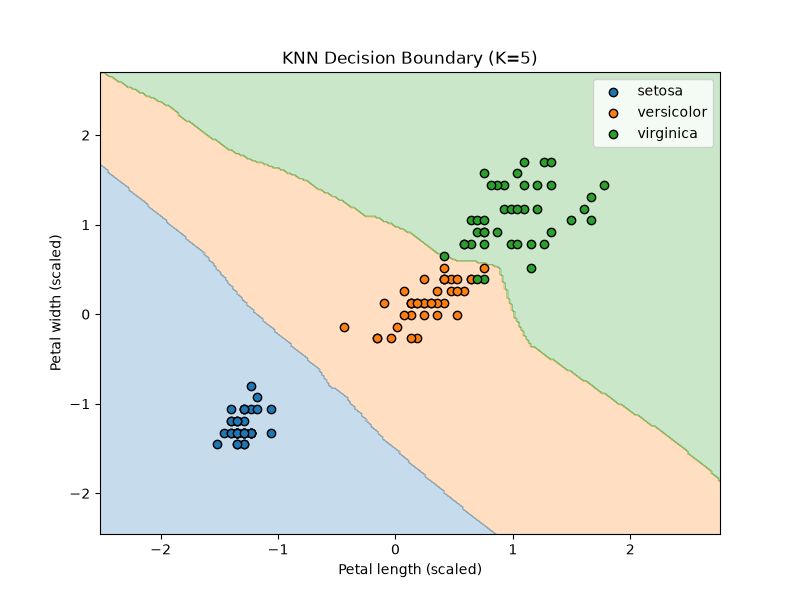

# Iris Flower Classification with K-Nearest Neighbors

Predicting iris species (setosa, versicolor, virginica) from four flower measurements using KNN, with a focus on honest evaluation: leakage-free scaling, K chosen by cross-validation, error analysis, and a multi-split comparison against two other models.

Project 2 of the AI Internship at DecodeLabs (Batch 2026): *Data Classification Using AI*.

## Results at a glance

| Metric | Value |
|---|---|
| Test accuracy (K=5, 30 test flowers) | **93.33%** (28/30) |
| Cross-validation error at K=5 (training set) | 3.33% |
| Mean accuracy over 20 random splits | KNN 96.00%, Decision Tree 95.67%, Logistic Regression 96.50% |

| Class | Precision | Recall | F1 |
|---|---|---|---|
| Setosa | 1.00 | 1.00 | 1.00 |
| Versicolor | 0.83 | 1.00 | 0.91 |
| Virginica | 1.00 | 0.80 | 0.89 |

Macro F1 is 0.93. The only 2 errors were Virginica flowers predicted as Versicolor.



## Dataset

The Iris dataset, loaded from scikit-learn: 150 samples, 4 features (sepal length/width, petal length/width in cm), 3 balanced classes (50 each), no missing values.



Setosa is cleanly separated. Versicolor and Virginica overlap, which is where the model's errors occur.

## Method

1. Load and inspect the data (shape, class balance, missing values, summary statistics).
2. Split 80/20, shuffled and stratified (`random_state=42`): 120 training and 30 test samples.
3. Scale features with `StandardScaler`, **fitted on the training set only** to avoid data leakage.
4. Train a KNN classifier (K=5 as the starting point).
5. Tune K from 1 to 25 using 5-fold cross-validation on the training data only. The test set is not used for tuning.
6. Evaluate on the test set: accuracy, confusion matrix, precision, recall, F1.
7. Compare with a Decision Tree and Logistic Regression.
8. Analyse the misclassified flowers.
9. Repeat the model comparison over 20 random splits.
10. Run side experiments: KNN settings, the effect of scaling, and a decision-boundary plot.

## Key findings

**K selection.** K=5, 6, 10 and 12 all reached the lowest cross-validation error (3.33%). I chose K=5 because it is the smallest of the tied values, sits in the stable region of the curve, and matches the default. One training flower out of 120 is about 0.83 percentage points, so the choice among tied values is not statistically meaningful.



**Error analysis.** Both mistakes have mixed measurements (for example, Versicolor-like petal length with Virginica-like petal width), sit where the two species' clusters meet, and lost a 3-to-2 neighbour vote. This is consistent with genuinely ambiguous flowers rather than a pipeline problem.



**Model comparison.** On the single test split all three models scored 93.33%, which says little with only 30 samples. Over 20 random splits:

| Model | Mean | Std | Min | Max |
|---|---|---|---|---|
| KNN | 96.00% | 3.43% | 86.67% | 100.00% |
| Decision Tree | 95.67% | 3.51% | 86.67% | 100.00% |
| Logistic Regression | 96.50% | 3.57% | 86.67% | 100.00% |

The gap between models (under 1 point) is much smaller than the split-to-split variation (about 3.5 points), so the three cannot be ranked on this evidence.



**KNN settings.** Uniform vs distance weighting gave identical cross-validation accuracy; Euclidean (96.67%) vs Manhattan (95.83%) differed by one training flower. I treat the settings as equivalent and kept the defaults.

**Scaling.** On the original Iris data, unscaled KNN scored 100% and scaled KNN 93.33%, a 2-flower difference that is within noise, so scaling is not shown to help here. In a synthetic test where sepal width was multiplied by 1000, unscaled accuracy fell to 66.67% and scaling restored it to 93.33%. Scaling is harmless on Iris and protects KNN when features are on very different scales.

**Decision boundary.** A KNN trained on petal length and petal width only shows three clear regions, with a smooth Setosa boundary and a more irregular Versicolor-Virginica boundary. This two-feature model scored 96.67% on the test split. That is within noise on 30 samples and is not evidence that fewer features are better.



## Limitations

- **Small test set.** 30 samples means one flower is 3.33 points. Single-split numbers can move noticeably.
- **Easy dataset.** Iris is small, clean and well separated, so these results may not carry over to harder problems.
- **K ties.** Four K values tied for best; the final choice is a judgement call, not a measured optimum.
- **Overlapping splits.** The 20 random splits reuse the same 150 samples, so they are not independent experiments; the std describes split sensitivity, not a true confidence interval.
- **Single confusion matrix.** It covers only the 30 test flowers. Cross-validated predictions over all 150 would be more reliable.
- **Synthetic scaling test.** The ×1000 sepal-width experiment is constructed to show the effect, not drawn from real data.
- **No deployment.** The model is not saved or served; the notebook is an analysis only.

## Next steps

- Wrap scaler and KNN in a scikit-learn `Pipeline` and tune `n_neighbors`, `weights` and `metric` with `GridSearchCV`.
- Use repeated stratified k-fold and `cross_val_predict` for a confusion matrix over all 150 samples.
- Save the model with `joblib` and add a small `predict.py` that takes four measurements and returns a species.
- Try a harder dataset, and move on to the next topic in the programme (CNNs).

## How to run

```bash
git clone https://github.com/<your-username>/<repo-name>.git
cd <repo-name>
pip install -r requirements.txt
jupyter notebook iris_knn.ipynb
```

Run all cells top to bottom (Kernel → Restart & Run All). The notebook creates the `images/` folder if it is missing.

## Project structure

```
├── iris_knn.ipynb      # full analysis, 27 steps
├── requirements.txt
├── README.md
└── images/             # figures used above
    ├── pairplot.png
    ├── k_vs_error.png
    ├── confusion_matrix.png
    ├── mistakes_plot.png
    ├── model_comparison.png
    └── decision_boundary.png
```

## Tech stack

Python, pandas, NumPy, matplotlib, seaborn, scikit-learn, Jupyter. Developed with scikit-learn 1.9.0, pandas 3.0.5, NumPy 2.5.1.